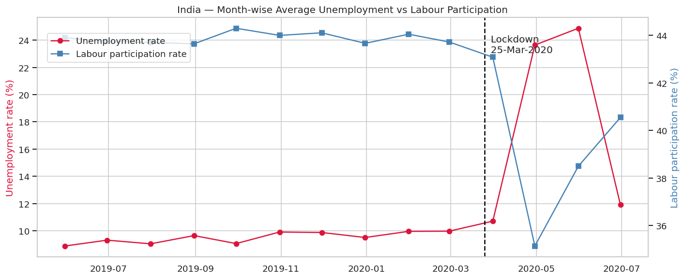
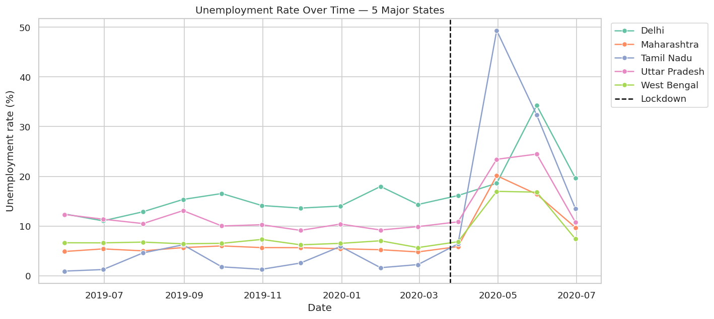
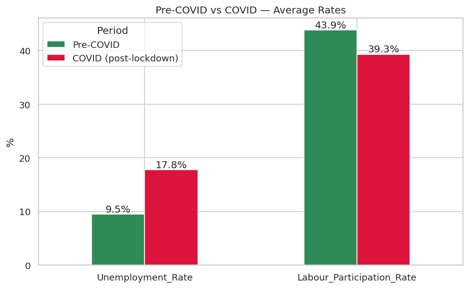

# 📉 Task 2 · Unemployment Analysis with Python

**Oasis Infobyte Internship (OIBSIP) · Data Science Track** · Vinay Singh Chaudhary

 

## 🎯 Objective
Explore Indian unemployment data to uncover regional and monthly trends, focusing on the impact of the COVID-19 lockdown (25 March 2020).

## 📦 Dataset
Kaggle — *Unemployment in India* (CMIE). `data/Unemployment_in_India.csv` (May 2019 – Jun 2020, 28 states, Rural/Urban) and `data/Unemployment_Rate_upto_11_2020.csv` (Jan – Oct 2020, with zones).

## 🛠️ Tech stack
Python · pandas · NumPy · matplotlib · seaborn · Jupyter

## 🧭 Approach
1. Cleaning — stripped column-name spaces, dropped 28 fully empty rows, parsed dates, standardised text
2. Region-wise averages and month-wise national trend (unemployment vs participation)
3. Time-series chart for 5 major states with the lockdown marked
4. Top-10 states bar chart and correlation heatmap
5. Pre-COVID vs post-lockdown comparison (national + state-level increase)
6. Extras — Rural vs Urban trend and zone-wise 2020 recovery

## 🏆 Results
| Indicator | Pre-COVID | Post-lockdown | Change |
|-----------|:---------:|:-------------:|:------:|
| Avg unemployment rate | 9.51 % | **17.77 %** | **+87 %** |
| Avg labour participation | 43.9 % | 39.3 % | −10 % |
| Avg employed (per record) | 7.47 M | 6.52 M | −13 % |

- National unemployment peaked at **~25 % in May 2020** and recovered to ~12 % by June.
- Highest average rates: **Tripura (28 %)**, **Haryana (26 %)**, Jharkhand, Bihar, Himachal Pradesh.
- Biggest lockdown jumps: **Puducherry, Tamil Nadu, Jharkhand, Bihar, Karnataka**.
- Urban unemployment is higher than rural at all times; all zones were back near pre-COVID levels by Aug–Oct 2020.

## 🖼️ Visual highlights
| **Monthly national trend** |
|:--:|
|  |

| **Major states over time** |
|:--:|
|  |

| **Pre vs post COVID** |
|:--:|
|  |

## 📁 Files
| File | Description |
|------|-------------|
| `VinaySinghChaudhary_Task2.ipynb` | Complete, commented and executed notebook |
| `outputs/` | All charts saved as PNG |
| `data/` | Dataset used in the notebook |

---

## ▶️ How to run
```bash
# from the OIBSIP root folder
pip install -r requirements.txt
cd DataScience-Task2-UnemploymentAnalysis
jupyter notebook VinaySinghChaudhary_Task2.ipynb
```
Then choose **Kernel ▸ Restart & Run All**. Every chart is displayed in the notebook and saved to `outputs/`.

## 🎥 Demo
📺 LinkedIn demo video: *link will be added after posting*

---
<sub>Part of my <a href="../">OIBSIP repository</a> · Oasis Infobyte Data Science Internship · Vinay Singh Chaudhary · #oasisinfobyte</sub>
