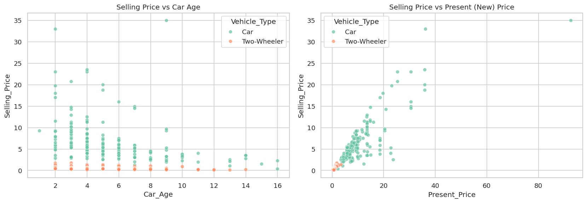
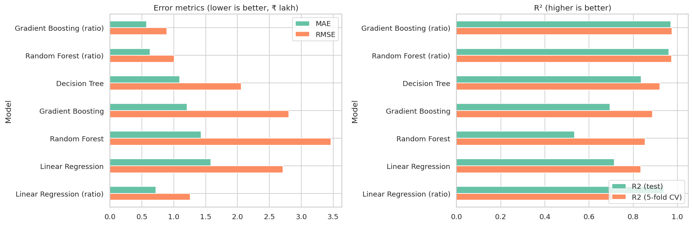
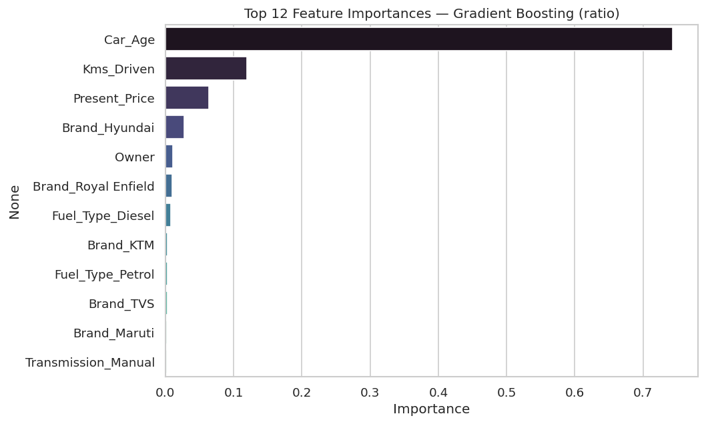

# 🚗 Task 3 · Car Price Prediction with Machine Learning

**Oasis Infobyte Internship (OIBSIP) · Data Science Track** · Vinay Singh Chaudhary

 

## 🎯 Objective
Predict the selling price of a used vehicle from its brand, age, kilometres driven, fuel type, seller type, transmission and new-vehicle price.

## 📦 Dataset
Kaggle — *Vehicle dataset from cardekho* (`data/car_data.csv`, 301 rows: cars and two-wheelers, prices in ₹ lakh).

## 🛠️ Tech stack
Python · pandas · NumPy · matplotlib · seaborn · scikit-learn · Jupyter

## 🧭 Approach
1. Cleaning — null check, 2 duplicates removed, text standardised (`'Petrol'`/`'petrol'`, double spaces)
2. Feature engineering — `Car_Age`, `Brand` (model→brand dictionary for names like *city*, *fortuner*), `Vehicle_Type`
3. EDA — price distribution (skewed), price vs fuel/transmission/seller box plots, price vs age scatter, brand averages
4. One-hot encoding + correlation heatmap
5. Round 1 — Linear Regression, Decision Tree, Random Forest, Gradient Boosting on raw price
6. Round 2 — **retained-value modelling**: predict `Selling_Price / Present_Price`, then multiply back
7. MAE / RMSE / R² + 5-fold CV, actual-vs-predicted plot, feature importance, price-prediction helper

## 🏆 Results
| Model | MAE (₹ lakh) | RMSE | R² test | R² 5-fold CV |
|-------|:-----:|:----:|:------:|:-----------:|
| **Gradient Boosting (ratio)** 🏆 | **0.58** | **0.89** | **0.97** | **0.98** |
| Random Forest (ratio) | 0.63 | 1.01 | 0.96 | 0.97 |
| Decision Tree | 1.09 | 2.06 | 0.84 | 0.92 |
| Gradient Boosting (raw price) | 1.21 | 2.80 | 0.70 | 0.89 |
| Linear Regression | 1.58 | 2.72 | 0.71 | 0.83 |

**Key idea:** modelling the *share of the new price a vehicle keeps* lets the model learn depreciation patterns that transfer from ₹ 0.5 lakh bikes to ₹ 30 lakh SUVs —
it halved the error. **Car age** is the dominant depreciation driver, followed by kilometres driven.

## 🖼️ Visual highlights
| **Price vs age and new price** |
|:--:|
|  |

| **Model comparison** |
|:--:|
|  |

| **Feature importance** |
|:--:|
|  |

## 📁 Files
| File | Description |
|------|-------------|
| `VinaySinghChaudhary_Task3.ipynb` | Complete, commented and executed notebook |
| `outputs/` | All charts saved as PNG |
| `data/` | Dataset used in the notebook |

---

## ▶️ How to run
```bash
# from the OIBSIP root folder
pip install -r requirements.txt
cd DataScience-Task3-CarPricePrediction
jupyter notebook VinaySinghChaudhary_Task3.ipynb
```
Then choose **Kernel ▸ Restart & Run All**. Every chart is displayed in the notebook and saved to `outputs/`.

## 🎥 Demo
📺 LinkedIn demo video: *link will be added after posting*

---
<sub>Part of my <a href="../">OIBSIP repository</a> · Oasis Infobyte Data Science Internship · Vinay Singh Chaudhary · #oasisinfobyte</sub>
