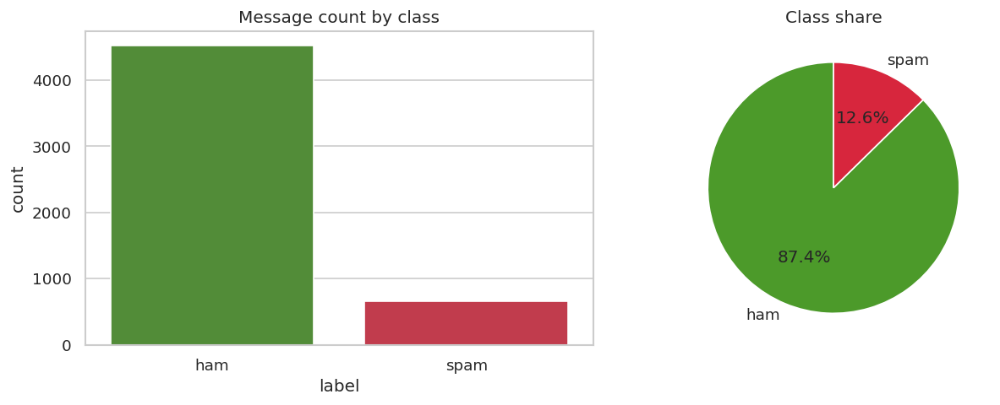
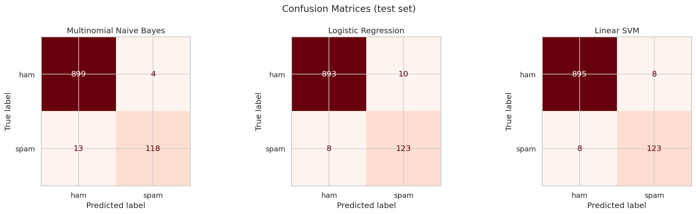
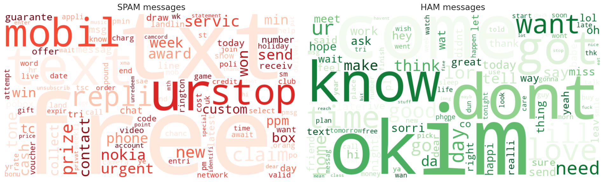

# 📧 Task 4 · Email Spam Detection with Machine Learning

**Oasis Infobyte Internship (OIBSIP) · Data Science Track** · Vinay Singh Chaudhary

 

## 🎯 Objective
Build an NLP binary classifier that distinguishes spam messages from legitimate (ham) messages.

## 📦 Dataset
SMS Spam Collection (UCI / Kaggle) — `data/spam.csv`, 5,572 messages → 5,169 after removing duplicates (≈ 13 % spam).

## 🛠️ Tech stack
Python · pandas · scikit-learn (TF-IDF, Naive Bayes, Logistic Regression, Linear SVM) · NLTK · re · WordCloud · Jupyter

## 🧭 Approach
1. Class distribution check (counts & %) and message-length analysis
2. Preprocessing — HTML unescape, lowercase, URL/money/number placeholders, punctuation & stop-word removal, Porter stemming
3. TF-IDF (unigrams + bigrams) with a markdown explanation of what TF-IDF measures
4. Stratified train/test split; Multinomial Naive Bayes, Logistic Regression, Linear SVM
5. Accuracy, precision, recall, F1, confusion matrices, 5-fold CV F1
6. Discussion: why recall matters for spam — plus decision-threshold tuning
7. Bonus: WordClouds for spam and ham, top spam-indicator words, live message tester

## 🏆 Results
| Model | Accuracy | Precision (spam) | Recall (spam) | F1 (spam) |
|-------|:--------:|:----------------:|:-------------:|:---------:|
| **Linear SVM** 🏆 | **98.5 %** | 93.9 % | 93.9 % | **0.939** |
| Multinomial Naive Bayes | 98.4 % | **96.7 %** | 90.1 % | 0.933 |
| Logistic Regression | 98.3 % | 92.5 % | 93.9 % | 0.932 |

Lowering Naive Bayes' threshold from 0.5 to **0.3** cuts missed spam from 13 → 5 (recall ≈ 96 %, precision ≈ 95 %).

## 🖼️ Visual highlights
| **Class distribution** |
|:--:|
|  |

| **Confusion matrices** |
|:--:|
|  |

| **WordClouds** |
|:--:|
|  |

## 📁 Files
| File | Description |
|------|-------------|
| `VinaySinghChaudhary_Task4.ipynb` | Complete, commented and executed notebook |
| `outputs/` | All charts saved as PNG |
| `data/` | Dataset used in the notebook |

---

## ▶️ How to run
```bash
# from the OIBSIP root folder
pip install -r requirements.txt
cd DataScience-Task4-EmailSpamDetection
jupyter notebook VinaySinghChaudhary_Task4.ipynb
```
Then choose **Kernel ▸ Restart & Run All**. Every chart is displayed in the notebook and saved to `outputs/`.

## 🎥 Demo
📺 LinkedIn demo video: *link will be added after posting*

---
<sub>Part of my <a href="../">OIBSIP repository</a> · Oasis Infobyte Data Science Internship · Vinay Singh Chaudhary · #oasisinfobyte</sub>
